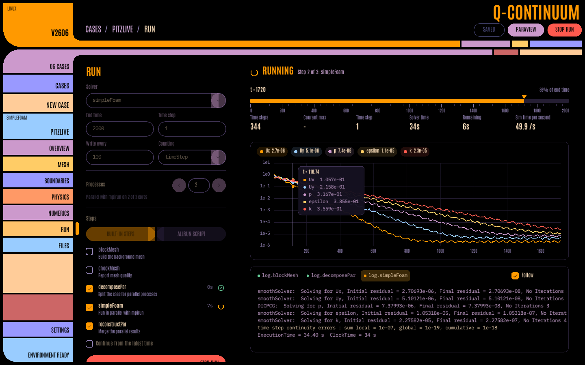
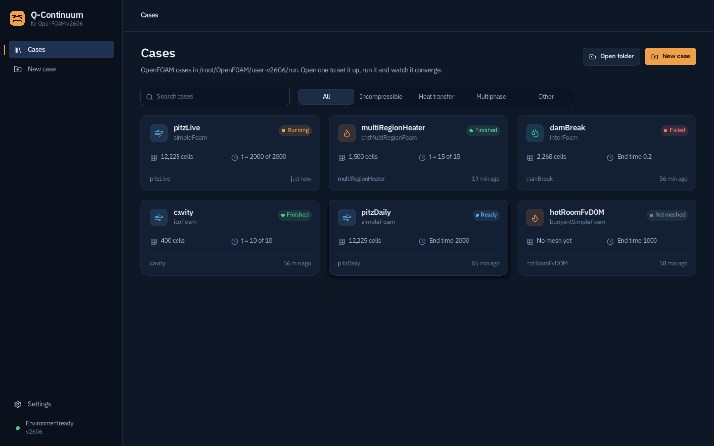
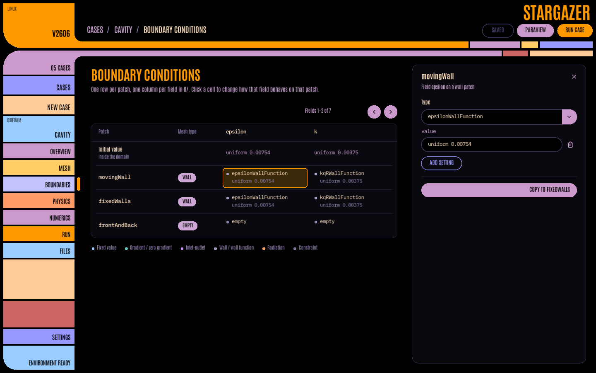
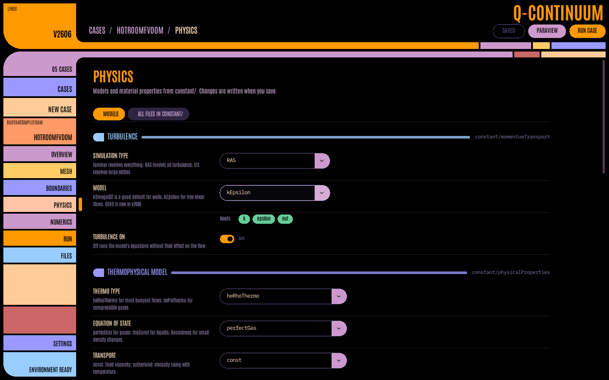

# Q-Continuum

First off, I would like to give a disclaimer that this is HEAVILY vibe coded, and still very early in "development." I don't have the experience nor the skills to make something even remotely close to this, but I still wanted to make something that would help lower the learning curve for some open source software for my peers. That being said, I am trying to learn C at the moment so that I can eventually improve this project on my own. Hope you 

A desktop workbench for simulations on Ubuntu 24.04 and WSL: **OpenFOAM v2606** first, and the same workflow for **DEME, Chrono, CalculiX, code_aster, code_saturne, MOOSE, Elmer and SPARTA** projects. It is styled after the LCARS starship consoles of *The Next Generation* by default, with iOS-style glass light and dark themes, two game themes and a JARVIS heads-up display. Q-Continuum handles setting up, running and watching cases. Post-processing stays in ParaView (or each program's own viewer), which Q-Continuum opens with one click.



## What it does

- **Every program, one workflow.** Projects of DEME, Chrono, CalculiX, code_aster, code_saturne, MOOSE, Elmer and SPARTA are found in each program's own folder (`~/deme`, `~/chrono`, `~/calculix`, `~/simvia/aster`, `~/simvia/saturne`, `~/moose`, `~/elmer`, `~/sparta`, where New case makes them; Settings → Workspace changes each), `~/OpenFOAM`, your home folder (two deep) and any folder added in Settings. Each gets the same pages as an OpenFOAM case:
  - **Overview**: status, the pre-run check, a look at the particles (DEME, SPARTA), the inputs, and the program's own GUI (code_saturne GUI, cgx, salome_meca).
  - **Setup**: the values in the input file (MOOSE blocks, Elmer sections, CalculiX cards, code_aster keyword arguments and `.export`, code_saturne `setup.xml`, SPARTA commands, DEME's `params.ini` form), edited in place with every other byte kept. Basic shows end time, time step, mesh size, materials and loads with units; All shows everything.
  - **Run**: input, processes or threads, checks with fixes (a copied code_aster `.export` pointing at another folder, a missing mesh, an unbuilt driver), live progress from the program's output, its residual-like values in the chart (MOOSE nonlinear residuals, CalculiX increments, code_saturne time residuals, Elmer changes, SPARTA particle counts, DEME kinetic energy), the log, the queue. DEME and Chrono drivers build first when their source changed.
  - **Results**: ParaView for ExodusII/VTK/EnSight, cgx for `.frd`, SALOME for MED, CSV tables as charts, and the built-in particle viewer for DEME frames and SPARTA dumps.
  - New case has starters (a Chrono pendulum checked against theory, CalculiX beam and heated slab, MOOSE conduction, Elmer heat, a SPARTA wedge, a code_aster thermal bar, the four DEME drivers, an empty code_saturne case) and the examples installed with the programs, copied so they run on their own (files borrowed from neighbouring examples brought along, README-generated inputs made). SPARTA inputs are checked against the styles your build has.
- **Review before writing.** Save, Ctrl+S and Run with unsaved edits show each file that would change, a line per changed entry (`deltaT: 0.005 → 0.0025`) and the diff, before anything is written ("Make it so" on the bridge).
- **Case manager.** Every case in your run folder shows up as a card with its solver, cell count and status (Ready, Running, Finished, Failed). You can search and filter by physics. New cases are cloned from any tutorial or from a set of starters (cavity, pitzDaily, damBreak, hotRoom with radiation, and others).
- **Case setup.** Pages for mesh, boundary conditions, physics and numerics edit the real OpenFOAM dictionaries. Edits change only the value you touch, so comments, `#include`s and layout stay as they were. Every file is also available as entries or raw text.
  - **Boundary conditions** is a patch × field matrix. Click a cell to change its type; the right default entries are filled in. Patch-group and regex entries are understood. Each field shows its unit (from its `dimensions`), fields the turbulence model doesn't read are marked *not used*, and hovering a field says what it is, its typical values and what the OpenFOAM tutorials start it at.
  - **Physics** covers turbulence (RAS/LES, including the required-field check), transport or phase properties, thermophysical models, gravity and radiation (P1 / fvDOM).
  - **Mesh** has blockMesh cell counts, scale and patch types. Generate and check the mesh from here.
  - **STL mesher** (Mesh page, or *Mesh an STL* on the Cases page): choose any STL, see whether it is closed, split it into named boundaries by angle, and mesh it the way STAR-CCM+'s automated mesher works: a base size, target and minimum surface sizes as percentages of it, surface curvature, growth rates, prism layers (number, total thickness, stretching) and volumetric controls (boxes, spheres, cylinders), inside the part or around it in a wind tunnel. The trimmed mesher is snappyHexMesh; with SALOME installed (`bash tools/install_salome.sh` after downloading it) the same settings make NETGEN tetrahedra, polyhedra (via polyDualMesh) or Body Fitting hexahedra, and *Open in SALOME* shows the result in its window.
- **Run & monitor.** Run tools in serial or with `mpirun` (decomposePar → solver → reconstructPar), or use the case's own `Allrun`. Multi-region (chtMultiRegionFoam) cases get topoSet, splitMeshRegions, per-region changeDictionary and `-allRegions` automatically. The monitor shows:
  - a live residual chart on a log scale
  - time progress, Courant number, time step and estimated time remaining
  - each log in a console you can search, jump to the first error in, and fold to one line per time step
  - a Commands tab with every command the app ran, each with a copy button that gives it as terminal commands
  - OpenFOAM's error message in plain words when a run fails, with the file and line and, for common mistakes, a one-click fix
  - **RED ALERT** when a run is diverging (residuals up a thousandfold, Courant blowing up, the time step collapsing): stop and write, halve the time step, or continue
- **SENSOR SWEEP.** Before a run, the case's dictionaries are checked for what would stop or spoil it: patches without a condition, missing schemes or linear solvers, pressure in the wrong units for the solver, a decomposition that doesn't multiply out, missing region files, no write before the end time, output larger than the free disk, leftover processor folders. Each finding opens its file at the line and, where it's safe, has a Fix button.
- **Coupled runs (preCICE).** Tutorials laid out as one folder per participant run as they are. Before a run, each participant is checked for what it needs (commands, Python modules, meshes), with a one-click fix where there is one.
- **Any solver.** Incompressible, heat transfer and radiation, multiphase and compressible solvers get tailored panels. Anything else still works through the generic dictionary editor and runner.
- **ParaView.** Q-Continuum writes `<case>.foam` and opens it in ParaView. On WSL it prefers the **Windows** ParaView, so you get your real GPU.
- **Interface.** The LCARS-style look is the default: black field, orange/lavender/periwinkle blocks, elbows and pill buttons, condensed capitals. Settings → Appearance switches to frosted glass (iOS-style, light or dark), Stardew Valley, Pokémon, JARVIS (Stark's heads-up display: cyan HUD brackets over a reactor-lit grid), Half-Life (Black Mesa gunmetal and lambda orange, an HEV suit on the Run page, HL2 and Garry's Mod sounds from `assets/sounds/halflife`, personal use only) and more. Each theme names the features its own way: the pre-run check is *Sensor sweep* on the bridge, *Morning field check* on the farm, *Pokédex scan* in the Pokémon theme, *Running diagnostics* for JARVIS and *Pre-run check* in glass. UI scaling for high-DPI screens.

| Cases | Boundary conditions | Physics |
|---|---|---|
|  |  |  |

LCARS-styled labels are capitalised, except OpenFOAM names (patches, fields, solvers), which keep their case because OpenFOAM is case-sensitive.

## Download

Get the code into your Linux **home folder** (`~`, i.e. `/home/<you>`) in either of two ways:

- **Download the ZIP.** On the repository's [Releases page](https://github.com/Elliott-D297/q-continuum/releases/latest), download `q-continuum_alpha2.0.zip` and unzip it into your home folder, so that you have `~/q-continuum_alpha2.0`. (*Code → Download ZIP* on the main page works too; that folder is called `q-continuum-main`, so use that name in the commands below, or rename it.)
- **Or clone it with git**, which makes updating easy (`git pull`):
  ```bash
  git clone https://github.com/Elliott-D297/q-continuum.git ~/q-continuum_alpha2.0
  ```

## Install on Ubuntu 24.04

```bash
cd ~/q-continuum_alpha2.0
bash install.sh                 # asks before installing OpenFOAM v2606 if it's missing
q-continuum
```

The installer:
1. Installs the build tools and X11/OpenGL headers with apt (it asks for your password).
2. Optionally installs OpenFOAM v2606 from openfoam.com:
   `curl -s https://dl.openfoam.com/add-debian-repo.sh | sudo bash`, then `sudo apt install openfoam2606-default`.
3. Builds Q-Continuum. raylib 5.5 is downloaded automatically and fonts and icons are embedded, so the binary is self-contained.
4. Installs it to `/usr/local/bin/q-continuum` with a menu entry and icon.

Options: `--with-openfoam`, `--no-openfoam`, `--user` (install to `~/.local`, no sudo for that step), `--uninstall`.

## Install on Windows with WSL

1. In **PowerShell (admin)**, run the following, then restart if asked:
   ```powershell
   wsl --install -d Ubuntu-24.04
   wsl --update
   ```
   `wsl --update` makes sure **WSLg** is present. WSLg is what lets Linux windows appear on your Windows desktop. Windows 11 has it built in; Windows 10 needs build 19044 or later.
2. Open **Ubuntu 24.04** from the Start menu and set up your Linux user when it asks.
3. Put Q-Continuum in your Linux home folder. Easiest is to clone it in the Ubuntu window:
   ```bash
   git clone https://github.com/Elliott-D297/q-continuum.git ~/q-continuum_alpha2.0
   ```
   Or download `q-continuum_alpha2.0.zip` from the [Releases page](https://github.com/Elliott-D297/q-continuum/releases/latest) in Windows, open your Linux home in Explorer (*Linux → Ubuntu-24.04 → home → <you>* in the sidebar, or type `\\wsl$\Ubuntu-24.04\home\<you>` in the address bar) and unzip it there, so that you have `q-continuum_alpha2.0` next to your other Linux files. Don't build it from `C:\` (`/mnt/c/...`): Windows drives are much slower from WSL.
4. Build and install it, with OpenFOAM:
   ```bash
   cd ~/q-continuum_alpha2.0
   bash install.sh --with-openfoam
   q-continuum
   ```
5. Install **ParaView for Windows** from <https://www.paraview.org/download/>. Q-Continuum finds it in `C:\Program Files\ParaView*` and opens your results there. The case path is translated with `wslpath`, so the files never leave WSL.

After installing, **Q-Continuum** also appears in the Windows Start menu, in the Ubuntu folder. This can take a minute, or a `wsl --shutdown`.

**If the window doesn't open:** run `wsl --update` and `wsl --shutdown` in PowerShell, then try again. If your GPU driver can't give WSL an OpenGL context, Q-Continuum automatically retries with Mesa's software renderer. You can force that with `LIBGL_ALWAYS_SOFTWARE=1 q-continuum`.

## Optional extras

- **SALOME** (for the STL mesher's tetrahedral, polyhedral and body-fitted meshers, and the SALOME script tab): download *SALOME 9.14 for Ubuntu 24.04* from <https://www.salome-platform.org/?page_id=2430> into your Downloads folder, then run `bash ~/q-continuum_alpha2.0/tools/install_salome.sh` and restart Q-Continuum. The snappyHexMesh mesher needs only OpenFOAM.
- **Theme sounds.** Every theme but the classic ones has built-in synthesised sounds (Settings → Appearance → Sounds). To use real clips instead, put `click.wav`, `click-2.wav` ..., `denied`, `error`, `done`, `alert` and `stopped` (`.wav`, `.ogg` or `.mp3`) in `~/.config/q-continuum/sounds/<theme>` (for example `sounds/halflife`; the LCARS ones go straight in `sounds/`). Clips from films and games are copyrighted, so none are included here.

## Updating

```bash
cd ~/q-continuum_alpha2.0
git pull                        # or download the new ZIP and unzip it over the old folder
bash install.sh --no-openfoam
```

## Using it

- **Settings** shows the OpenFOAM installations it found under `/usr/lib/openfoam`, `/opt` and `~/OpenFOAM`. You can also point it at any `etc/bashrc`, for example a source build. Every tool runs in a fresh `bash` that sources that file, so you don't need to source anything yourself.
- The workspace defaults to `~/OpenFOAM/<user>-v2606/run`, which is OpenFOAM's own convention. **Open folder** adds a case from anywhere.
- Every job writes `log.<tool>` in the case folder, just as `runApplication` does. Logs are read live, so a run started from a terminal shows up in the monitor too.
- **Stop** sends SIGTERM to the whole process group (mpirun and all ranks), and SIGKILL after 4 s.
- Edits are held until you press **Save** (Ctrl+S). **Ctrl+Z** and **Ctrl+Y** undo and redo dictionary edits.
- If a file changes on disk, for example when you edit it in VS Code, Q-Continuum reloads it and says so. Unsaved edits to other entries are kept; if you changed the same entry, it shows both versions and asks which to keep.
- **Ctrl+K** opens the Computer: one search over commands, pages, cases, patches, fields and every keyword in the case. `deltaT = 0.001` (or `PISO/nCorrectors = 3`) sets an entry, with the old and new value shown first.
- **F1** lists every command with its keyboard shortcut (Ctrl+R run, Ctrl+M mesh, Ctrl+P ParaView, Ctrl+1 to Ctrl+8 for the case pages).
- The app reopens the last case and page when it starts.
- To open a case directly: `q-continuum ~/OpenFOAM/$USER-v2606/run/cavity`.

Settings are stored in `~/.config/q-continuum/settings.ini`.

## Building by hand

```bash
sudo apt install build-essential cmake git libx11-dev libxrandr-dev libxinerama-dev \
                 libxcursor-dev libxi-dev libgl1-mesa-dev
cmake -B build -DCMAKE_BUILD_TYPE=Release
cmake --build build -j
./build/q-continuum
```

Use `-DQC_RAYLIB_DIR=/path/to/raylib-5.5` to build against a local raylib instead of downloading it.

## Source layout

| File | Purpose |
|---|---|
| `src/foamdict.c` | Format-preserving OpenFOAM dictionary parser and editor |
| `src/foamcase.c` | Case scanning, fields, patches, status and tutorial index |
| `src/runner.c` | Job runner (bash + etc/bashrc, process groups), log parser and the record of commands run |
| `src/actions.c` | The action registry: every command with its shortcut, button and help |
| `src/undo.c` | Undo and redo of dictionary edits |
| `src/logview.c` | The log console: search, folding, the Commands tab |
| `src/fieldinfo.c` | Field units, descriptions and the tutorials' typical values |
| `src/sweep.c` | SENSOR SWEEP: the pre-run checks |
| `src/explain.c` | The error translator: FOAM FATAL messages explained, with fixes |
| `src/redalert.c` | RED ALERT: divergence watch over the solver log |
| `src/palette.c` | The Computer (Ctrl+K) search bar |
| `src/env.c` | Install detection, settings, ParaView and WSL launchers |
| `src/ui.c` | Immediate-mode UI toolkit on raylib |
| `src/page_*.c` | The individual pages |

## Licences and trademarks

Q-Continuum's source is yours to use and modify. Bundled fonts: IBM Plex and Antonio (both SIL Open Font License 1.1) and Lucide icons (ISC). The licences are in `assets/fonts/`. raylib is zlib-licensed.

This offering is not approved or endorsed by OpenCFD Limited, producer and distributor of the OpenFOAM software via www.openfoam.com, and owner of the OPENFOAM® and OpenCFD® trade marks. ParaView is a trademark of Kitware, Inc. Star Trek and LCARS belong to Paramount; Q-Continuum is an unofficial fan-styled tool with no connection to them.

## Upgrading from Plenum

Q-Continuum is the same app under a new name. The installer removes the old `plenum` command and menu entry, and your settings are carried over from `~/.config/plenum` the first time Q-Continuum starts.
